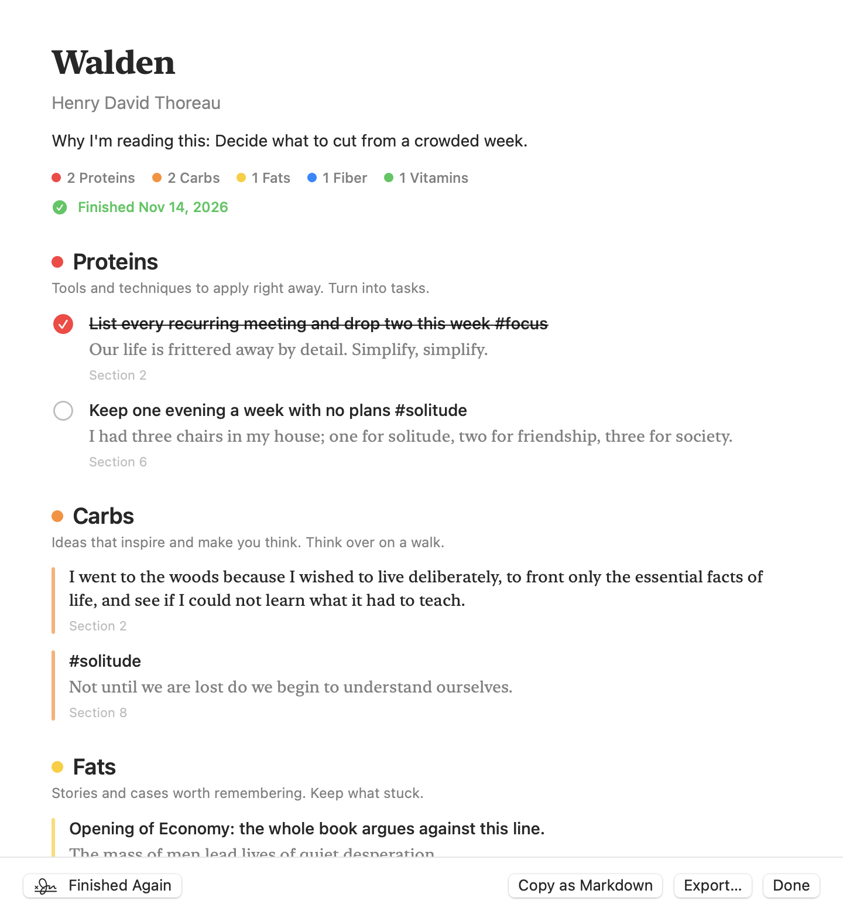
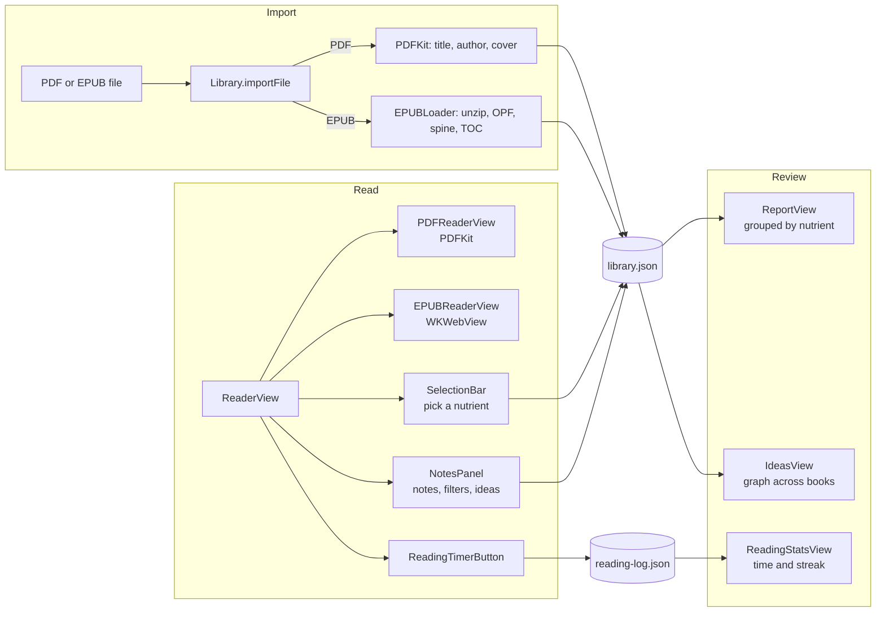
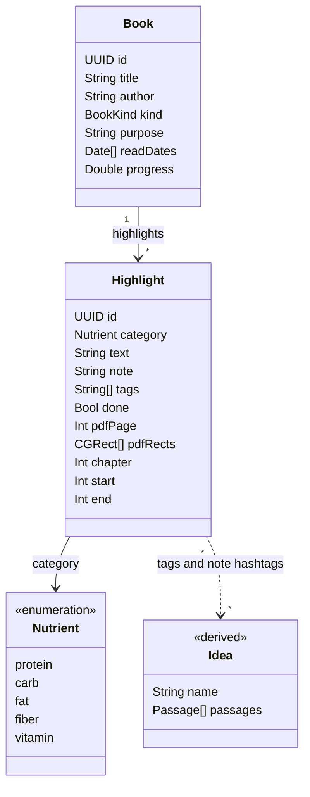

# Margins

A native Mac reader for PDF and EPUB that sorts every highlight by what it is good for, then turns them into a checklist, linked ideas and an end-of-book report.

## Why

Most highlights die in the book. You mark a passage, close the app, and the useful part (the thing you meant to try, the story you wanted to retell) is never seen again. Generic highlighters treat every passage the same, so there is no way to tell "apply this on Monday" from "nice quote".

Margins is built around Margulan Seisembai's reading method, which sorts what you read by what it is good for, like nutrients in food. You decide the category at the moment you highlight, so when you finish the book the work is already sorted: the tools become a checklist, the ideas go on a walk with you, the facts go into your next talk.



*The end-of-book report, rendered from the app's own SwiftUI view with sample highlights from public-domain books.*

## What it does

| Colour | Nutrient | What belongs here | What to do with it after the book |
|---|---|---|---|
| Red | **Proteins** | Tools and techniques to apply right away | Turn into tasks |
| Orange | **Carbs** | Ideas that inspire and make you think | Think over on a walk |
| Yellow | **Fats** | Stories and cases worth remembering | Keep what stuck |
| Blue | **Fiber** | Facts, figures and references | Reference for talks |
| Green | **Vitamins** | Quotes, jokes and anecdotes | Use in conversation |

- **Read PDF and EPUB** in one library. Drop a file on the window or press `+`.
- **Highlight by purpose.** Select text and pick a colour, or press `⌘1` to `⌘5`.
- **Write a note on any highlight.** Point at a highlight to see its note; click it in the side panel to jump to it.
- **Link ideas across books.** Type a hashtag such as `#focus` in a note, or add an idea with the picker. Every passage that shares an idea is connected, across every book, in the Ideas view (`⇧⌘I`).
- **Decide why before you start.** Each book has a "Why I'm reading this" field at the top of the notes panel.
- **Track reading time.** A timer in the reader toolbar counts time per book; Reading Time shows today, the last 7 days, all time, your streak and time per book.
- **Get an end-of-book report** (`⇧⌘R`): everything grouped by nutrient, Proteins as a checklist, copy or export as Markdown. "Mark as Finished" signs and dates the book; two reads make it a Classic.

## How it works

Margins is about 3,500 lines of Swift with no third-party packages. PDFs render with PDFKit; EPUBs are unzipped once and shown in a WebKit view, with highlights stored as character offsets inside each chapter.



### Data model



`purpose` is the "why I'm reading this" line, `readDates` holds one date per completed read (two make a Classic), `done` drives the Proteins checklist, and PDF highlights store page plus rectangles while EPUB highlights store chapter plus character offsets.

Ideas are not stored separately. They are derived on the fly from each highlight's `tags` plus any `#hashtag` in its note, so there is no separate list to keep in sync.

## Quick start

Requirements: macOS 14 or newer, Xcode 16 or newer.

```bash
git clone https://github.com/stanislavli3/margins.git
cd margins
open Margins.xcodeproj   # then press ⌘R
```

Without the Xcode project:

```bash
swift run
```

To install it as a regular app in `/Applications` (builds a Release copy, backs up your library first, then swaps the app):

```bash
bash install.sh
```

### Keyboard shortcuts

| Shortcut | Action |
|---|---|
| `⌘1` to `⌘5` | Highlight as Proteins, Carbs, Fats, Fiber, Vitamins |
| `⇧⌘R` | End-of-book report |
| `⇧⌘I` | Ideas graph (from the library) |
| `⌘+` / `⌘-` | Text size |

## Your data is protected

Everything is stored in `~/Library/Application Support/Margins`. Nothing leaves your Mac.

- Every field in `library.json` falls back to a default if it's missing, so adding a field in a new version doesn't make old files unreadable. When you add a field to `Book` or `Highlight`, add a line for it in the decoders at the bottom of `Models.swift`.
- If the file can't be read anyway, Margins shows a "Library Not Loaded" screen and saves nothing, so the file is never overwritten. A copy goes to `Backups/unreadable-….json`.
- Margins never replaces a library that has books with an empty one, unless you deleted the last book yourself.
- Only one copy of Margins can write at a time. A second copy opens read-only.
- `library.previous.json` holds the version from before the latest save.
- `Backups/library-YYYY-MM-DD.json`: one copy per day the app is opened (last 60 kept).
- `Backups/before-install-….json`: made by `install.sh` before every update.

To restore, quit Margins and copy any backup over `library.json`.

## Project layout

| File | What it holds |
|---|---|
| `Models.swift` | `Book`, `Highlight`, `Nutrient`, reader themes, Markdown report, tolerant decoders |
| `Library.swift` | Loading, saving, locking, backups, importing PDF and EPUB |
| `EPUB.swift` | Minimal EPUB loader: unzip, OPF metadata, spine, table of contents |
| `PDFReader.swift`, `EPUBReader.swift` | The two readers and how highlights are drawn and hit-tested |
| `ReaderView.swift` | Reader window, toolbar and the nutrient picker |
| `NotesPanel.swift` | Side panel: purpose, filters, notes, ideas per highlight |
| `Ideas.swift` | Idea parsing, the idea index, the graph and the per-idea page |
| `ReadingLog.swift` | Reading timer and reading-time stats |
| `ReportView.swift` | End-of-book report |
| `LibraryView.swift` | Library grid and book cards |

## Credits

The reading method, including the five nutrient categories and what to do with each, is Margulan Seisembai's. Margins is an independent app by [Stanislav Li](https://github.com/stanislavli3) that puts the method into a reader.
